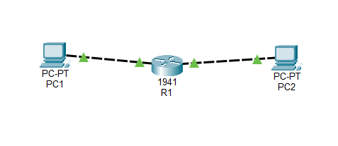
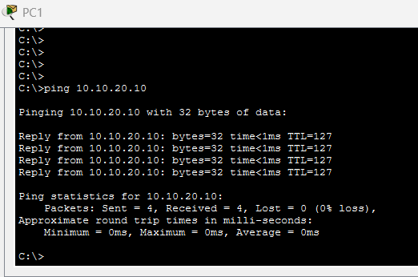
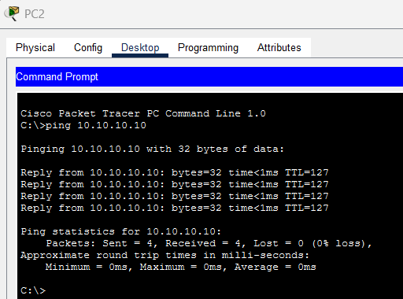

# Day 2 - Router Configuration

## Objective
Configure a Cisco router to connect
two separate LANs.

## IP Addressing

| Device | IP Address |
|---|---|
| R1 G0/0 | 10.10.10.1/24 |
| R1 G0/1 | 10.10.20.1/24 |
| PC1 | 10.10.10.10/24 |
| PC2 | 10.10.20.10/24 |

## Router Interface Configuration

| Interface | IP Address | Status |
|---|---|---|
| G0/0 | 10.10.10.1/24 | Up/Up |
| G0/1 | 10.10.20.1/24 | Up/Up |

## Routing Table

| Route | Network | Interface |
|---|---|---|
| C | 10.10.10.0/24 | G0/0 |
| L | 10.10.10.1/32 | G0/0 |
| C | 10.10.20.0/24 | G0/1 |
| L | 10.10.20.1/32 | G0/1 |

## Verification Commands

- show ip interface brief
- show ip route
- show running-config

## Connectivity Verification

| Test | Result | Packet Loss |
|---|---|---|
| PC1 to PC2 | PASS | 0% |
| PC2 to PC1 | PASS | 0% |

## Routing Verification

- G0/0: 10.10.10.1/24 - Up/Up
- G0/1: 10.10.20.1/24 - Up/Up
- Both LANs are directly connected.
- No static routes required.

## Troubleshooting

No connectivity failures were observed
during the final verification tests.

## Lessons Learned

- Configured router interfaces.
- Verified connected and local routes.
- Examined the routing table.
- Tested communication between subnets.
- Achieved 0% packet loss.

## Router Configuration

[View R1 Configuration](R1-config.txt)

## Network Topology

## Connectivity Test Evidence

### PC1 to PC2

**Result:** PASS - 0% packet loss

### PC2 to PC1

**Result:** PASS - 0% packet loss
